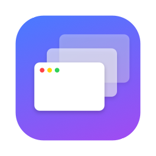
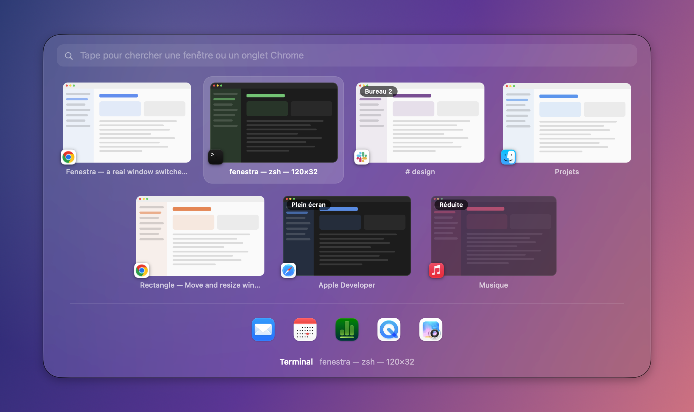
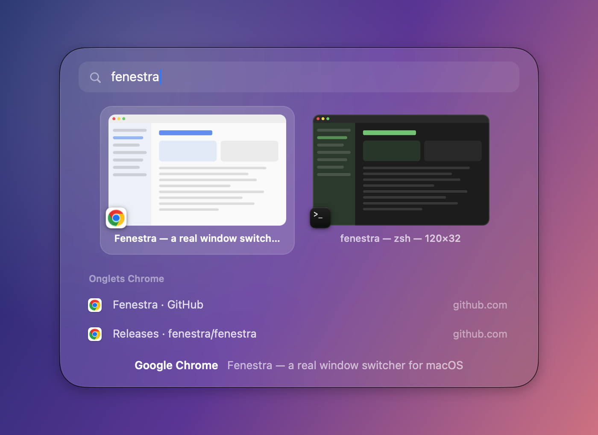

<p align="center">
  
</p>

<h1 align="center">Fenestra</h1>

<p align="center">
  <b>A real window switcher for macOS.</b><br>
  <kbd>⌘</kbd> <kbd>⇥</kbd> shows every window, not just apps, with previews, search, Chrome tabs and keyboard tiling.
</p>

<p align="center">
  
</p>

<p align="center"><a href="README.fr.md">🇫🇷 Lire en français</a></p>

## Why

macOS's <kbd>⌘</kbd><kbd>⇥</kbd> switches between **apps**. With three Chrome windows, a terminal and a Slack
window on another desktop, reaching the right one means ⌘⇥, then ⌘\`, then guessing.

Fenestra replaces ⌘⇥ with a switcher that lists **every window**, like Alt-Tab on Windows, and adds what
macOS is missing around it.

## Features

- **Every window, with a preview** — most recently used first, minimized windows included.
- **All desktops and full-screen apps** — tagged *Bureau 2* or *Plein écran*; picking one takes you there.
- **Type to search** — filter windows **and Chrome tabs** by app, title or website. Case and accents are ignored.
- **The front app's windows only** — with macOS's own "next window" key: <kbd>⌘</kbd><kbd>\`</kbd>
  on a US keyboard, <kbd>⌘</kbd><kbd><</kbd> on a French one.
- **Window tiling** — <kbd>⌃</kbd><kbd>⌥</kbd> + arrows for halves (press again for ⅓ then ⅔), thirds,
  full screen and centre.
- **Hide everything** — <kbd>⌥</kbd><kbd>⌘</kbd><kbd>M</kbd> clears the screen; press it again to bring it all back.
- **Window actions without leaving ⌘⇥** — close a window or a tab, minimize, hide or quit an app.
- **Made for macOS 26** — Liquid Glass panel, Stage Manager aware, AZERTY / QWERTY aware.
- **Never takes ⌘⇥ hostage** — pause or quit Fenestra (or let it crash) and macOS gets its shortcuts back.

<p align="center">
  
</p>

## Install

### Download

**[⬇︎ Download Fenestra.zip](https://github.com/theopqrs/fenestra/releases/latest/download/Fenestra.zip)** —
macOS 14 Sonoma or later, Apple silicon or Intel.

1. Unzip it and drag **Fenestra** into **Applications**.
2. Open it. macOS says it could not verify the app: click **Done**.
3. In **System Settings › Privacy & Security**, click **Open Anyway** next to *“Fenestra” was blocked…*
   and confirm.

Fenestra is free and open source but not notarized by Apple (that takes a paid developer account),
hence this one-time confirmation. In the Terminal, steps 2 and 3 can be replaced by
`xattr -dr com.apple.quarantine /Applications/Fenestra.app`.

### Build from source

Requirements: **macOS 14 Sonoma or later** (developed on macOS 26 / 27) and Xcode or the Command Line
Tools (Swift 5.10+).

```bash
git clone https://github.com/theopqrs/fenestra.git
cd fenestra
./build.sh --install
```

`build.sh` compiles a release build, wraps it in `Fenestra.app`, signs it with your Apple Development
certificate when you have one (ad hoc otherwise), copies it to `/Applications` and launches it.
Without `--install`, the app is left in `build/`.

### Permissions

Fenestra lives in the menu bar (no Dock icon). On first launch, allow it in
**System Settings › Privacy & Security**:

| Permission | Used for | Needed |
| --- | --- | --- |
| **Accessibility** | catching ⌘⇥, listing, focusing and moving windows | yes |
| **Screen Recording** | window previews | no — app icons otherwise |
| **Automation › Google Chrome** | searching Chrome tabs | no — windows only otherwise |

> With an ad-hoc signature, macOS forgets the permissions at every rebuild. Signing with a real
> certificate (the script picks one automatically) keeps them.

## Shortcuts

### The switcher

| Keys | Action |
| --- | --- |
| <kbd>⌘</kbd><kbd>⇥</kbd> / <kbd>⌘</kbd><kbd>⇧</kbd><kbd>⇥</kbd> | open, next / previous window |
| <kbd>←</kbd> <kbd>→</kbd> <kbd>↑</kbd> <kbd>↓</kbd> | move around the grid |
| release <kbd>⌘</kbd> or <kbd>↩</kbd> | go to the selected window |
| any letter | search — the panel then stays open until <kbd>↩</kbd> or <kbd>esc</kbd> |
| <kbd>⌫</kbd> | delete a search character |
| <kbd>⌥</kbd><kbd>W</kbd> | close the window, or the tab |
| <kbd>⌥</kbd><kbd>M</kbd> | minimize / restore the window |
| <kbd>⌥</kbd><kbd>H</kbd> | hide / show the app |
| <kbd>⌥</kbd><kbd>Q</kbd> | quit the app |
| <kbd>esc</kbd> | cancel |

A quick ⌘⇥ tap jumps straight back to the previous window without showing anything. The mouse works too:
hover to select, click to go.

### Everywhere

| Keys | Action |
| --- | --- |
| <kbd>⌘</kbd><kbd>\`</kbd> (<kbd>⌘</kbd><kbd><</kbd> on AZERTY) | switcher limited to the front app's windows |
| <kbd>⌥</kbd><kbd>⌘</kbd><kbd>M</kbd> | hide every app / show them back |
| <kbd>⌃</kbd><kbd>⌥</kbd><kbd>←</kbd> <kbd>→</kbd> | left / right half — again for ⅓, then ⅔ |
| <kbd>⌃</kbd><kbd>⌥</kbd><kbd>↑</kbd> <kbd>↓</kbd> | top / bottom half — again for ⅓, then ⅔ |
| <kbd>⌃</kbd><kbd>⌥</kbd><kbd>↩</kbd> | fill the screen — again to restore |
| <kbd>⌃</kbd><kbd>⌥</kbd><kbd>C</kbd> | centre |
| <kbd>⌃</kbd><kbd>⌥</kbd><kbd>D</kbd> <kbd>F</kbd> <kbd>G</kbd> | left / centre / right third |
| <kbd>⌃</kbd><kbd>⌥</kbd><kbd>⌫</kbd> | back to the size before tiling |

Every feature can be switched off from the menu bar icon, which also lists these shortcuts.

## How it works

For the curious, and for anyone who wants to hack on it:

- **Keyboard** — a `CGEventTap` on its own thread. While Fenestra runs, the system's ⌘⇥ and "next window"
  shortcuts are turned off (`CGSSetSymbolicHotKeyEnabled`) and restored on pause, quit or crash.
- **Windows** — the Accessibility API for the current desktop; SkyLight
  (`CGSCopyWindowsWithOptionsAndTags`) for the other desktops and full-screen apps, whose Accessibility
  elements are cached as they are met or found by brute force (the technique AltTab uses).
- **Order** — focus changes are followed through Accessibility notifications, so the order is the real order
  of use across desktops.
- **Focus** — `_SLPSSetFrontProcessWithOptions` plus key-window events (as in yabai and AltTab), which also
  switches to the window's desktop.
- **Previews** — `CGSHWCaptureWindowList`. macOS does not render windows parked in Stage Manager's strip or on
  hidden desktops, so Fenestra captures each window while it is visible and keeps its last image in memory
  and in `~/Library/Caches`.
- **Chrome tabs** — AppleScript run by `osascript`, reading every title and URL in a few bulk requests.

## Limitations

- **Private macOS APIs.** That is what makes the above possible, but it rules out the App Store and a macOS
  update may break something.
- **The interface is in French** for now.
- A window that has never been on screen since Fenestra started shows its app icon instead of a preview.
- Tab search covers Google Chrome only (other Chromium browsers would be a few lines away).
- macOS blocks keyboard event taps while a password field has the focus, so ⌘⇥ does nothing there.

## Development

```
Sources/Fenestra/
├── AppDelegate.swift          menu bar, permissions, takes over / restores the native shortcuts
├── KeyboardInterceptor.swift  event tap, turns key presses into commands
├── SwitcherController.swift   one ⌘⇥ session: list, search, select, act
├── SwitcherPanel.swift        the panel and its tiles
├── WindowManager.swift        windows of every desktop, order of use, focus
├── ThumbnailProvider.swift    previews and their cache
├── Search.swift               matching and ranking
├── BrowserTabs.swift          Chrome tabs through AppleScript
├── WindowTiling.swift         ⌃⌥ tiling
├── HideAll.swift              ⌥⌘M
├── PrivateAPI.swift           SkyLight / HIServices symbols, loaded at runtime
├── DemoContent.swift          made-up windows for the screenshots
└── main.swift                 app entry point and debug modes
```

Debug modes (run through `open` so they get the app's permissions):

```bash
open -n -W /Applications/Fenestra.app --stdout /tmp/fenestra.txt --args --list   # windows, desktops, previews
open -n -W /Applications/Fenestra.app --stdout /tmp/fenestra.txt --args --tabs   # Chrome tabs
open -n -W /Applications/Fenestra.app --stdout /tmp/fenestra.txt --args --tiling-test
open -n -W /Applications/Fenestra.app --args --demo-screenshot docs/switcher.png  # README screenshots
```

Publishing a version: `./release.sh 1.1.0` builds a universal app, zips it and creates the GitHub release
(install notes from [`docs/install.md`](docs/install.md)).

## Credits

Fenestra stands on techniques documented by [AltTab](https://github.com/lwouis/alt-tab-macos),
[yabai](https://github.com/koekeishiya/yabai) and [Rectangle](https://github.com/rxhanson/Rectangle).
Thanks to their authors.

## License

[MIT](LICENSE) © theopqrs
